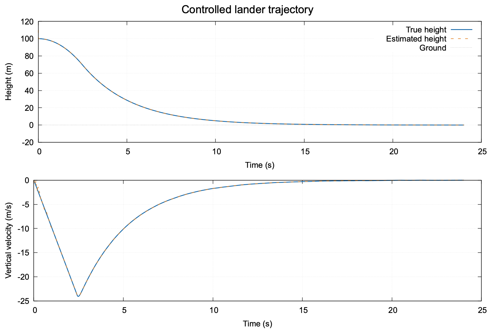
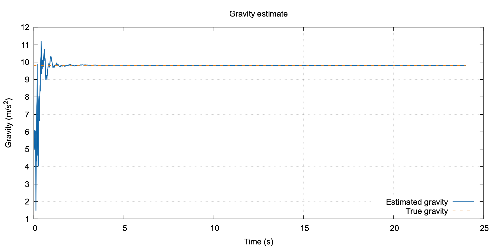

# MECHTRON 4AX3 - Assignment 4: Lander

## Objective

The lander starts at a height of $100\,\mathrm{m}$ with zero vertical velocity. The goal is to reach the ground at $h=0$ with vertical velocity as close to zero as possible. The simulated gravity is $9.81\,\mathrm{m/s^2}$, but the observer and controller do not use its true value. The supplied Kalman and DARE implementations are used without modification.

## Model and implementation

The plant state is $[h,v]^T$. Upward engine acceleration is $u\geq 0$. The discrete simulation uses

$$
h_{k+1}=h_k+v_k\,dt,\qquad
v_{k+1}=v_k+(u_k-g+w_k)\,dt,
$$

where $w_k$ is a random acceleration disturbance. The only direct sensor measurement is noisy height: $y_k=h_k+n_k$.

The Kalman observer estimates $[\hat h,\hat v,\hat g]^T$. It predicts the next state using the previous estimate and engine input, then corrects the prediction with the measured height. Gravity is treated as an unknown but constant state. Its matrices are

$$
A_o=\begin{bmatrix}1&dt&0\\0&1&-dt\\0&0&1\end{bmatrix},\quad
B_o=\begin{bmatrix}0\\dt\\0\end{bmatrix},\quad
C_o=\begin{bmatrix}1&0&0\end{bmatrix}.
$$

The controller uses $s=[\hat h,\hat v]^T$. Defining net acceleration as $a=u-g$ gives

$$
s_{k+1}=A_cs_k+B_ca_k,\qquad
A_c=\begin{bmatrix}1&dt\\0&1\end{bmatrix},\quad
B_c=\begin{bmatrix}0\\dt\end{bmatrix}.
$$

The supplied DARE class computes a feedback gain $K_k$ for each step. The main program calculates $a_k=-K_ks_k$ and converts it to an engine command with the estimated gravity:

$$
u_k=\max(0,\hat g_k+a_k).
$$

The lower bound prevents downward thrust. Each loop iteration uses the current posterior estimate to calculate $u$, advances the plant, generates a height measurement, and updates the observer for the next iteration.

## Parameters

| Parameter | Value | Purpose |
| --- | ---: | --- |
| Time step, dt | 0.01 s | Discrete simulation step |
| Horizon | 6000 steps | Maximum simulation time of 60 s |
| True initial state | $h=100$ m, $v=0$ m/s | Plant starting point |
| Initial observer estimate | $[110,0,5]^T$ | Initial height, velocity, and gravity guesses |
| Acceleration disturbance standard deviation | 0.1 m/s² | Random $w_k$ in the plant |
| Height measurement standard deviation | 0.1 m | Random $n_k$ in the sensor |
| Observer process covariance, Q | $\mathrm{diag}(0,10^{-6},0)$ | $Q_{vv}=dt^2(0.1)^2$ |
| Observer measurement covariance, R | $0.01$ | $R=(0.1)^2$ |
| Initial observer covariance, P | $\mathrm{diag}(100,1,100)$ | Initial estimate uncertainty |
| Controller state cost, Q_c | $\mathrm{diag}(10,80)$ | Height and velocity weights |
| Controller input cost, R_c | $0.5$ | Net acceleration weight |
| Random seed | 42 | Reproduces the same noisy trajectory and plots |

Q and R are fixed covariance values; the random samples enter the plant and sensor equations. Gravity has no process noise because it remains constant in this simulation.

## Build and regenerate the plots

Run these commands from the A4 directory:

~~~sh
clang++ -std=c++17 -O2 -I/opt/homebrew/include/eigen3 main.cpp kalman.cpp DARE.cpp -o lander
./lander > landing_output.txt
cd result
gnuplot plot.gnuplot
~~~

The main program writes result/landing_data.dat with time, true height, true velocity, estimated height, estimated velocity, estimated gravity, and engine input. The gnuplot script in result reads this data and generates the two figures below.

## Result

With seed 42, the lander crosses the ground at $t=24.02\,\mathrm{s}$ with $h=-1.93\times10^{-5}\,\mathrm{m}$ and $v=-0.00354\,\mathrm{m/s}$. The final gravity estimate is $9.81042\,\mathrm{m/s^2}$, close to the true value of $9.81\,\mathrm{m/s^2}$. Engine input stays nonnegative, and this trajectory continues descending until touchdown. The small negative final height is one time step of numerical ground crossing; the velocity is near zero rather than mathematically exact zero.

### Landing trajectory: height and vertical velocity

### Gravity estimate

For the paper submission, print main.cpp and both figures.
